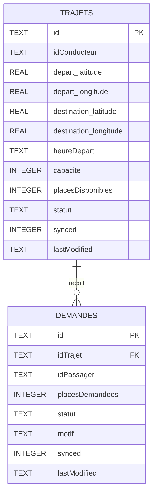

# Schéma de Base de Données Locale (SQLite) - CovoitGo Mobile

Dans le cadre de l'**Étape 6 (Synchronisation base locale / distante)**, l'application mobile Flutter utilise une base de données relationnelle locale **SQLite** (`covoitgo.db`).

Elle permet à l'application de fonctionner en mode **Offline-First** : l'utilisateur peut consulter ses données et créer des trajets même sans connexion Internet.

---

## 1. Code pour générer le diagramme sur [ToDiagram.com](https://todiagram.com)

Vous pouvez utiliser au choix l'un des deux formats ci-dessous dans l'éditeur de **ToDiagram.com** :

### Option A : Format JSON (recommandé pour ToDiagram)
Collez ce code en choisissant le format **JSON** dans ToDiagram. Il affichera clairement les tables `trajets` et `demandes` avec leurs colonnes :

```json
{
  "sqlite_covoitgo_db": {
    "table_trajets": {
      "id": "TEXT (PRIMARY KEY)",
      "idConducteur": "TEXT",
      "depart_latitude": "REAL",
      "depart_longitude": "REAL",
      "destination_latitude": "REAL",
      "destination_longitude": "REAL",
      "heureDepart": "TEXT",
      "capacite": "INTEGER",
      "placesDisponibles": "INTEGER",
      "statut": "TEXT",
      "synced": "INTEGER (0 = pending, 1 = synced)",
      "lastModified": "TEXT (ISO timestamp)"
    },
    "table_demandes": {
      "id": "TEXT (PRIMARY KEY)",
      "idTrajet": "TEXT (FOREIGN KEY -> trajets.id)",
      "idPassager": "TEXT",
      "placesDemandees": "INTEGER",
      "statut": "TEXT",
      "motif": "TEXT",
      "synced": "INTEGER (0 = pending, 1 = synced)",
      "lastModified": "TEXT (ISO timestamp)"
    }
  }
}
```

---

### Option B : Format Mermaid (Diagramme Entité-Relation)
Collez ce code en choisissant le format **Mermaid** dans ToDiagram :



---

## 2. Structure SQL des Tables (implémentée dans `database_helper.dart`)

```sql
CREATE TABLE trajets (
  id TEXT PRIMARY KEY,
  idConducteur TEXT NOT NULL,
  depart_latitude REAL NOT NULL,
  depart_longitude REAL NOT NULL,
  destination_latitude REAL NOT NULL,
  destination_longitude REAL NOT NULL,
  heureDepart TEXT NOT NULL,
  capacite INTEGER NOT NULL,
  placesDisponibles INTEGER NOT NULL,
  statut TEXT NOT NULL,
  synced INTEGER NOT NULL,
  lastModified TEXT NOT NULL
);

CREATE TABLE demandes (
  id TEXT PRIMARY KEY,
  idTrajet TEXT NOT NULL,
  idPassager TEXT NOT NULL,
  placesDemandees INTEGER NOT NULL,
  statut TEXT NOT NULL,
  motif TEXT NOT NULL,
  synced INTEGER NOT NULL,
  lastModified TEXT NOT NULL
);
```

---

## 3. Rôle des champs de synchronisation

Pour répondre aux exigences de synchronisation bidirectionnelle :
* **`synced`** :
  * `0` (*Pending*) : La donnée a été créée ou modifiée localement hors ligne. Elle doit être envoyée au serveur MongoDB dès que la connexion est rétablie.
  * `1` (*Synced*) : La donnée est synchronisée avec la base distante MongoDB.
* **`lastModified`** : Horodatage ISO (ex: `2026-10-02T10:00:00Z`). Utilisé lors de la synchronisation pour résoudre les éventuels conflits entre la version mobile et la version serveur (*Last-Write-Wins*).
